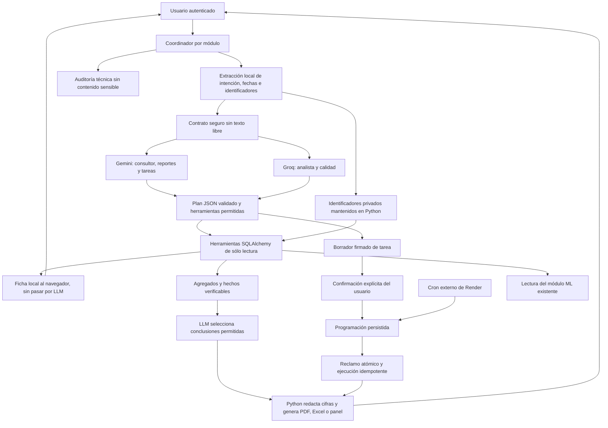

# Sistema multiagente de CLINICA_P

> Ampliación posterior: [Perfil, archivos y notificaciones](PERFIL_AUTOMATIZACION.md).
> Esa guía reemplaza las limitaciones de esta versión inicial sobre cuenta sin
> perfil, avisos sólo en panel, archivos regenerados y vencimientos sin recuperación.
> El cron recomendado ahora revisa cada cinco minutos y distingue su origen.

## Alcance implementado

Cinco agentes especializados, un coordinador, contratos Pydantic, herramientas
Python autorizadas, auditoría y páginas de reportes, tareas y calidad. El ML
continúa independiente: ningún agente entrena modelos ni calcula pronósticos.

La aplicación existente utiliza una única cuenta de doctor/administrador.
Las capacidades se asignan por configuración del servidor, sin inventar roles
ni permisos por paciente que no existen en el proyecto. No se cambiaron claves,
credenciales, tablas clínicas ni datos productivos.

## Agentes

| Agente | Proveedor y modelo | Herramientas | Límite principal |
|---|---|---|---|
| Consultor clínico | Gemini `gemini-3.5-flash-lite` | buscar paciente, consultar historial, informar campos ausentes | Sólo lectura local de fichas; no envía identificadores al LLM |
| Analista inteligente | GroqCloud `openai/gpt-oss-20b` | estadísticas por período, comparación, campos ausentes, emisiones ML | Sólo agregados; no SQL ni texto clínico libre |
| Generador de reportes | Gemini `gemini-3.5-flash-lite` | construir reporte con secciones validadas | Cifras, tablas, gráficos y documentos generados por Python |
| Automatizador de tareas | Gemini `gemini-3.5-flash-lite` | preparar borrador, listar tareas, consultar ML | El modelo nunca confirma ni activa programaciones |
| Control de calidad | GroqCloud `openai/gpt-oss-20b` | analizar calidad por reglas | Sólo categorías agregadas al LLM; nunca corrige, fusiona o elimina |

Cada agente es una clase especializada de `Agente` con prompt propio,
capacidad, proveedor y lista de herramientas. El registro central asocia cada
herramienta con una función y un esquema de argumentos. No se ejecutan nombres
de funciones, SQL o código arbitrarios devueltos por los modelos.

La interpretación recibe un esquema con los códigos de hechos de esa consulta
como enumeración, una lista explícita y un ejemplo válido. Con Groq GPT-OSS
20B/120B se envía como `json_schema` con `strict: true`; otros modelos conservan
el modo JSON con validación local. El plan de herramientas mantiene JSON porque
sus argumentos son abiertos. Las conclusiones y acciones rechazadas no se muestran
como aportes de IA. Esto corrige la ambigüedad que producía
`conclusion_sin_sustento` al comparar períodos.

## Arquitectura y comunicación



El chat sólo enruta al consultor o al analista. Los otros tres agentes funcionan
desde sus páginas. Los reportes pueden solicitar una revisión adicional de
Groq con una casilla explícita. Por defecto, cada consulta llama únicamente al
proveedor de su agente. Una tarea de reporte invoca al agente de reportes al
ejecutarse; las tareas de estadísticas/alertas reutilizan herramientas
deterministas, sin llamadas LLM adicionales innecesarias.

Hay un cliente cacheado por proveedor y configuración en cada proceso. Se
reutilizan los SDK `google-genai` y `groq`; no se abren cinco clientes.

## Privacidad y límites

- El texto libre del chat o de la solicitud de tarea se interpreta localmente.
  No se transmite al proveedor, aunque contenga nombres, DNI, teléfonos,
  direcciones, diagnósticos o instrucciones maliciosas.
- El planificador recibe intención canónica, fechas validadas, opciones y
  contratos. En clínica recibe solamente indicadores como presencia de una
  referencia o contexto seleccionado. El valor del identificador queda local.
- La selección de paciente se limita a las opciones que el servidor guardó en
  la sesión. Una consulta ambigua sobre otra persona no reutiliza el paciente
  anterior. Las coincidencias múltiples muestran botones de selección.
- Las fichas se formatean localmente y se muestran con `textContent`.
- No se envían motivos, síntomas, diagnósticos, recetas, nombres, domicilios,
  identificadores de filas ni incidencias individuales para interpretación.
- Las conclusiones son redacción controlada: el LLM selecciona y ordena códigos
  de hechos calculados; Python inserta las cifras en plantillas. No se acepta
  prosa numérica libre. Esto limita deliberadamente el estilo del informe para
  impedir cantidades o porcentajes inventados.
- Los planes no pueden ampliar rangos ni cambiar parámetros autorizados. Una
  herramienta ajena, un argumento adicional o una conclusión desconocida se
  rechazan. Se ofrece el resultado determinista, claramente marcado sin IA.
- Inputs de texto: 500 caracteres; cuerpo JSON: 16 KB declarados. Períodos:
  máximo 366 días. Búsqueda y calidad: límite de 5.000 registros, sin presentar
  un muestreo como revisión completa. Incidencias del panel: primeras 200,
  indicando truncamiento. Historial técnico: últimas 50 ejecuciones.
- Timeout de proveedor configurable entre 3 y 30 segundos (15 por defecto).
  Sin reintentos ocultos de los SDK. Límite compartido por las ejecuciones
  registradas en el último minuto: 12 por defecto; no es una cuota transaccional
  exacta ante solicitudes concurrentes.
- 401 para API sin sesión; 403 por capacidades o CSRF. Los POST de reportes,
  calidad y tareas requieren un token CSRF vinculado a la sesión.
- Respuestas de estos módulos con `Cache-Control: no-store`. Auditoría y
  errores no guardan prompts, datos clínicos, claves ni cuerpos del proveedor.

Si Gemini o Groq fallan, hay datos deterministas disponibles y el plan local
es válido, la respuesta se marca `degradado`. No se atribuye una conclusión
inventada a una IA que no respondió. La indisponibilidad de base de datos se
informa con 503 y sin exponer parámetros SQL.

## Datos realmente disponibles

El esquema actual tiene pacientes, atenciones, fechas, motivos, síntomas,
diagnósticos y recetas. NO tiene servicios, médicos responsables, costos o
ingresos. Se informa esa ausencia; no se equipara un motivo clínico con un
servicio ni se deducen costos. No se añadieron columnas financieras o médicas
con valores ficticios. Esos análisis y controles negativos quedan pendientes
de una ampliación autorizada del esquema y datos registrados.

Las estadísticas se consultan con funciones SQLAlchemy compatibles con SQLite
y PostgreSQL. Los meses se agrupan a partir de fechas agregadas, sin funciones
SQL específicas de un solo motor. Ausencia de registros no equivale a cero
actividad confirmada.

El ML se lee mediante `ml.artefactos.metadatos()` y `ml.pronosticos.consultar()`.
Se conservan versión, resultados, comparación con referencias y condición
experimental. Cuando no hay emisiones se informa, sin generar otras. Las
alertas ALTA no se evalúan como negativas si no hay emisiones disponibles.

## Reportes

Página `/reportes-inteligentes`: elegir tipo, fechas y secciones. Los tipos
diario, semanal y mensual validan respectivamente un día, siete días o un mes
completo. El tipo rango admite hasta 366 días.

Python consulta sólo las secciones seleccionadas. Los informes guardan su
período y fecha de generación. El preview muestra conteos, gráfico mensual,
detalle diario y conclusiones. PDF usa ReportLab con gráficos vectoriales;
Excel usa OpenPyXL, fechas/cantidades tipadas y gráfico nativo. Los documentos
se producen en memoria al descargarse; no dependen de archivos efímeros del
servidor. El contenido agregado del informe se conserva en la base.

ML es una sección opcional con las emisiones existentes de los próximos siete
días desde la generación; se distingue del período histórico del reporte.
PDF/Excel conservan la advertencia experimental y la comparación con referencias.
La revisión Groq adicional también se incorpora a las exportaciones.

## Automatización

Página `/automatizacion-tareas`:

1. Escribir la tarea: reporte, resumen, consulta ML o alerta ALTA.
2. Revisar configuración canónica, frecuencia y hora de Perú.
3. Confirmar explícitamente. Hasta entonces no hay una tarea persistida.
4. Consultar tareas, activar/desactivar o ejecutar una tarea ya confirmada.
5. Revisar resultados, errores e intentos en el panel.

Ejemplos: `Genera un reporte todos los lunes a las 08:00`, `Prepara un resumen
mensual el día 15 a las 09:00`, `Avísame cuando exista demanda ALTA`.
El parser local admite horas enteras, frecuencias diaria/semanal/mensual,
días semanales y días mensuales 1–28. Los valores omitidos se muestran en la
vista previa: 08:00, lunes para semanal, día 1 para mensual.

La confirmación usa un token firmado con caducidad de diez minutos y un nonce
asociado a la sesión. El LLM no recibe ni genera ese token. Repetir la
confirmación conserva el mismo identificador de tarea. Canal único: panel;
no hay integración de email, SMS o mensajería ni se afirma que se enviaron avisos.

El programador es un comando externo; no hay hilos ni entrenamiento dentro de
Flask. Reclama cada ejecución con `INSERT ... ON CONFLICT DO NOTHING` y clave
única tarea/fecha elegible. Un proceso concurrente no puede ejecutar el mismo
reclamo. Los reintentos de error tienen comparación atómica y máximo tres
intentos; un reclamo interrumpido puede recuperarse después de diez minutos.
Los informes programados usan identificador determinista para no duplicar el
documento si se interrumpe el proceso después de guardarlo.

El reporte diario cubre ayer; semanal, los siete días cerrados anteriores;
mensual, el mes anterior completo. Las estadísticas generan un snapshot en el
resultado de la ejecución. Alertas/consulta ML leen emisiones existentes.
No se duplica el cron de pronósticos del ML.

Se registra cada revisión del comando programador aunque no haya tareas. El
panel muestra su última revisión registrada, o informa que no hay evidencia
de ejecución. Esa marca no prueba que exista un cron activo: también puede
provenir de una ejecución manual del comando. Si una tarea falla, el comando
sale con código distinto de cero y conserva el error técnico para reintentar.
Los vencimientos sólo se revisan en el día elegible; no hay recuperación de
todas las fechas históricas omitidas mientras el programador estuvo detenido.

## Calidad

Página `/calidad-datos`: elegir período y ejecutar revisión. Se revisa el padrón
completo de pacientes, porque no existe fecha de actualización suficiente para
atribuir la calidad demográfica a un período. Las atenciones corresponden al
rango y a registros con fecha nula, que se distinguen en el alcance.

Reglas: campos obligatorios vacíos, formato de DNI, fecha de nacimiento inválida
o futura, atenciones sin motivo/paciente/fecha, estado desconocido y fecha de
atención futura. Grupos con nombre normalizado y fecha de nacimiento coincidentes
se marcan como posibles duplicados. No se corrige ningún dato.

Los indicadores distinguen registros sin/con incidencias; una fila con varias
incidencias se cuenta una vez en ese indicador y varias veces en las categorías.
Groq recibe sólo los indicadores agregados. La tabla autorizada contiene entidad,
ID local y categoría; no se transmite a Groq. Los costos no se evalúan porque el
campo no existe.

## Tablas y migración aditiva

Nuevas tablas: `agente_ejecuciones`, `agente_informes`, `agente_tareas` y
`agente_tarea_ejecuciones`. Se crean con `checkfirst=True`; no se alteran ni
eliminan tablas clínicas o ML. JSON es soportado por SQLite y PostgreSQL; los
reclamos usan la implementación de conflicto del dialecto correspondiente.
No se usa `drop_all()`.

## Variables de entorno

| Variable | Uso |
|---|---|
| `GEMINI_API_KEY` | Clave Gemini existente; nunca incluida en documentos o logs |
| `GROQ_API_KEY` | Clave GroqCloud existente |
| `GEMINI_MODEL` | `gemini-3.5-flash-lite` por defecto; se respeta el valor explícito existente |
| `GROQ_MODEL` | `openai/gpt-oss-20b` por defecto |
| `AGENTES_TIMEOUT` | Timeout por llamada; 15 segundos por defecto |
| `AGENTES_POR_MINUTO` | Límite aproximado por auditoría; 12 por defecto |
| `AGENTES_PERMISOS` | Lista CSV de capacidades; por defecto `pacientes,estadisticas,reportes,tareas,calidad,auditoria` |
| `DATABASE_URL` | Configuración existente; no se cambia automáticamente |
| `SECRET_KEY` | Clave existente de sesión y firma de borradores |
| `ML_MODEL_DIR` | Directorio ya existente de artefactos ML confiables |

Las capacidades son globales para la cuenta compartida actual. No sustituyen
un sistema futuro de usuarios, roles y autorizaciones por expediente.

## Ejecutar localmente

Con Python 3.12 y el entorno creado para ML:

```powershell
.\.ml-venv\Scripts\python.exe -m pip install -r requirements.txt
.\.ml-venv\Scripts\python.exe -m llm.cli inicializar --database sqlite:///C:/Users/USER/Downloads/clinica-app/clinica-app/instance/policlinico_ficticio.db
.\.ml-venv\Scripts\python.exe -m flask --app app run --host 127.0.0.1 --port 5000
```

Acceder con las credenciales existentes a `http://127.0.0.1:5000/login`.
Usar Asistente IA, Reportes inteligentes, Automatización de tareas, Calidad de
datos y Actividad de agentes desde el menú. Para una prueba con datos del
historial local, el rango 2026-01-01 a 2026-09-30 contiene 1.000 atenciones.

Otros comandos (usan `.env`; especificar `--database` si procede):

```powershell
.\.ml-venv\Scripts\python.exe -m llm.cli estado
.\.ml-venv\Scripts\python.exe -m llm.cli ejecutar
.\.ml-venv\Scripts\python.exe -m llm.cli verificar-proveedores
.\.ml-venv\Scripts\python.exe -m unittest discover -s tests -v
.\.ml-venv\Scripts\python.exe -m pip check
node --check static/js/agentes.js
node --check static/js/asistente_ia.js
```

`verificar-proveedores` realiza una llamada JSON genérica por proveedor, sin
consultar fichas ni enviar estadísticas; no debe incluirse en pruebas rutinarias.
No hay cambio silencioso de modelo si falla: se devuelve un código de estado.

## Rutas nuevas y conservadas

Se conservan `/asistente-ia` y `POST /api/asistente-ia`, así como todas las rutas
de pacientes, atenciones, reportes tradicionales y ML.

| Ruta | Método y función |
|---|---|
| `/reportes-inteligentes` | GET, página del agente 3 |
| `/automatizacion-tareas` | GET, página del agente 4 |
| `/calidad-datos` | GET, página del agente 5 |
| `/actividad-agentes` | GET, auditoría autorizada |
| `/api/agentes/reportes` | GET historial / POST crear informe |
| `/api/agentes/reportes/<uuid>/pdf` | GET descarga PDF |
| `/api/agentes/reportes/<uuid>/xlsx` | GET descarga Excel |
| `/api/agentes/tareas/preview` | POST borrador sin persistencia de tarea |
| `/api/agentes/tareas/confirmar` | POST token y `confirmar: true` |
| `/api/agentes/tareas` | GET tareas, ejecuciones y revisión del programador |
| `/api/agentes/tareas/<uuid>` | POST activar/desactivar con booleano `activa` |
| `/api/agentes/tareas/<uuid>/ejecutar` | POST `ejecutar: true`, tarea confirmada y activa |
| `/api/agentes/calidad` | POST fechas, validación e interpretación |
| `/api/agentes/ejecuciones` | GET historial técnico de agentes |

## Render (preparado, no desplegado)

1. Mantener el servicio web `gunicorn app:app`, su `DATABASE_URL` y credenciales.
2. Instalar `requirements.txt` actualizado con Python 3.12.
3. Ejecutar `python -m llm.cli inicializar` una vez en una base autorizada antes
   de activar las nuevas funciones.
4. Crear un Cron Job separado con comando `python -m llm.cli ejecutar`.
5. Programación sugerida `0 * * * *`: una revisión por hora. Render usa UTC y el
   código calcula los vencimientos en Perú.
6. Compartir `DATABASE_URL`, claves de proveedor, identificadores y permisos
   adecuados con el cron. Si usa reportes con ML, incluir los mismos artefactos
   versionados que el servicio web.
7. Confirmar al menos una tarea desde su página; ejecutar el cron manualmente
   para verificar la revisión registrada y los resultados. No activar tareas
   productivas como parte de una prueba sin autorización.

`render.agentes.yaml.example` es un ejemplo revisable. No crea recursos ni
activa programaciones. Los cron de Render no acceden a discos persistentes;
programaciones, resultados e informes se guardan en PostgreSQL y las descargas
se generan desde ese contenido. El cron ML ya existente se mantiene separado.

Fuentes oficiales consultadas:
- [Gemini 3.5 Flash-Lite](https://ai.google.dev/gemini-api/docs/models/gemini-3.5-flash-lite).
- [Salidas estructuradas Groq](https://console.groq.com/docs/structured-outputs).
- [Cron Jobs de Render](https://render.com/docs/cronjobs).

## Archivos de esta ampliación

Nuevos: `llm/base.py`, `llm/clientes.py`, `llm/esquemas.py`, `llm/privacidad.py`,
`llm/herramientas.py`, `llm/auditoria.py`, `llm/reportes.py`, `llm/tareas.py`,
`llm/cli.py`, `templates/agentes.html`, `static/js/agentes.js`,
`static/css/agentes.css`, `tests/test_agentes.py`, `render.agentes.yaml.example`,
esta guía, `docs/AGENTES_RESULTADOS.md` y la captura `docs/agentes-reportes.png`.

Modificados: `models.py`, `llm/coordinador.py`, `llm/rutas.py`, `llm/consultas.py`,
`llm/asistente.py`, `llm/agente_groq.py`, `templates/base.html`,
`templates/asistente_ia.html`, `static/js/asistente_ia.js`,
`static/css/asistente_ia.css`, `requirements.txt` y `README.md`.

Los adaptadores antiguos siguen disponibles, pero ya no transmiten resúmenes o
análisis arbitrarios a los proveedores: utilizan el coordinador seguro.

## Pruebas y pendientes

Ver `AGENTES_RESULTADOS.md`. Las pruebas de proveedores usan mocks, y las de
integración usan SQLite aislado. PostgreSQL se valida mediante compilación DDL;
no se probó una instancia viva porque no se proporcionó un entorno autorizado.
Se mantienen las 18 pruebas del módulo ML.

Pendientes explícitos: activar cron/servicios en Render, verificar contra una
base PostgreSQL de pruebas, incorporar roles por usuario y permisos por paciente
si se amplía la cuenta compartida, añadir columnas reales de servicios/médicos/
costos con su migración autorizada, y conectar un canal real de notificaciones
si se necesita fuera del panel. No se modificó ni desplegó producción.
