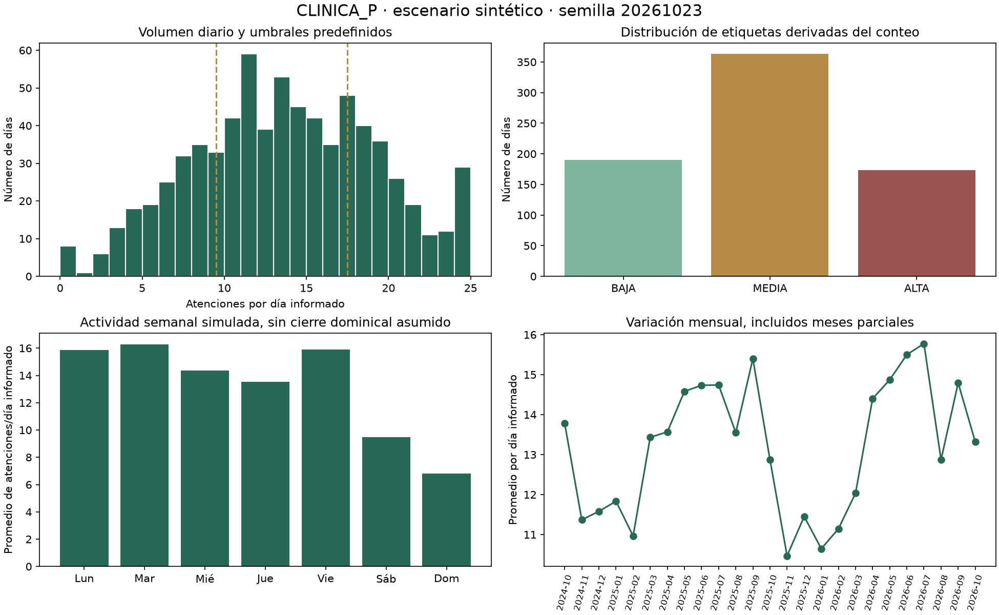
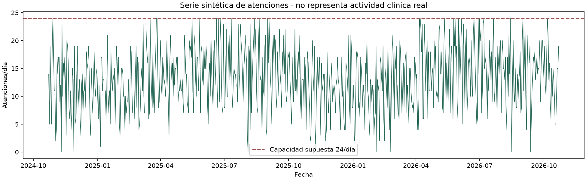

# Datos sintéticos y evaluación de CLINICA_P

## Objetivo y alcance

Construir un escenario académico reproducible de un policlínico pequeño, con identidades ficticias y patrones temporales ruidosos. No son atenciones reales ni una muestra representativa de Yanahuanca. No se consultó RENIEC ni se descargaron identidades.

El historial se instaló en la base principal `instance/policlinico_ficticio.db` el 23/10/2026, por autorización del propietario. Se conserva un respaldo completo anterior en `instance/respaldos/`. El puntero habitual de ML ya selecciona los nuevos modelos. Supabase requiere ejecutar el SQL indicado al final de esta guía.

## Diagnóstico original

La SQLite local existente tenía 420 pacientes, 1.000 atenciones, 273 días agregados y 60 pronósticos v2 al comenzar. Los 420 identificadores eran de nueve dígitos con prefijo 90. Ya había perfiles, informes, auditoría y una tarea: no se deben sustituir ni perder. No se encontró un generador reutilizable.

Relaciones: `pacientes → atenciones`; los agregados diarios y pronósticos ML usan fecha. Las tareas tienen ejecuciones; los archivos apuntan a informes, propietarios y opcionalmente tareas; las notificaciones apuntan a cuenta/informe/tarea. La actualización sólo sustituye pacientes, atenciones, agregados y pronósticos. Conserva íntegros el perfil, las tareas, los informes históricos, archivos y auditoría. Los informes antiguos son instantáneas del historial anterior; deben regenerarse para describir el nuevo conjunto.

El esquema no contiene servicio, profesional responsable ni costo. No se añadieron valores ficticios a campos inexistentes. Las validaciones económicas se declaran no aplicables.

## Resumen medido

| Variable | Valor |
|---|---:|
| Pacientes | 1000 |
| Atenciones | 9569 |
| Período | 2024-10-23 a 2026-10-22 |
| Días informados | 726 |
| Días sin información | 4 |
| Días explícitos con cero | 8 |
| Promedio por día informado | 13.18 |
| Máximo diario | 24 |
| Pacientes con varias atenciones | 999 |
| Discrepancias entre agregados y atenciones | 0 |

La ventana comprende 24 meses y 730 fechas de calendario. Los extremos mensuales son parciales. Cada paciente tiene al menos una atención; 999 tienen más de una. Los días sin información no se rellenan como cero.

## Reglas fijadas antes del entrenamiento

- Semilla única `20261023`, NumPy PCG64; no se probaron semillas para escoger métricas favorables.
- Capacidad hipotética: 24 turnos de 20 minutos entre 08:00 y 16:00. Es un supuesto, no un horario real verificado.
- BAJA 0–9, MEDIA 10–17 y ALTA 18–24: cortes de carga aproximados de 40 % y 75 %. No se eligieron mirando el conjunto de prueba ni por cuantiles de la reserva.
- Medias de llegada previas al ruido por lunes–domingo: 16, 17, 15, 14, 16, 10 y 7. Hay actividad los domingos y feriados; no se asumió cierre.
- Estacionalidad anual moderada, amplitud 1,8; componente AR(1) con coeficiente 0,45 e innovación normal de desviación 1,5; conteos Poisson.
- Reducción media de 3,5 en feriados nacionales. El calendario incorpora fechas fijas y Jueves/Viernes Santo, no días compensables ni feriados regionales.
- Probabilidades por fecha: 0,8 % sin información; entre las fechas informadas, 0,6 % cierre excepcional y 1,9 % de aumento y 2 % de reducción excepcional. El resto conserva fluctuaciones aleatorias.
- El volumen se limita a 24: representa atenciones realizadas dentro de la capacidad hipotética, no toda la demanda insatisfecha. No se mide lista de espera.
- Los motivos, síntomas y diagnósticos se eligen como grupos coherentes de un catálogo sintético; no son prescripciones ni evidencia clínica.
- Identificadores de texto de ocho dígitos, prefijos variados y unicidad. Ningún prefijo demuestra edad, región o identidad. Pueden coincidir accidentalmente con números asignados, por lo que no se validan externamente.
- Nombres combinados de vocabulario ficticio. Teléfonos, vías, recetas, notas y coordenadas quedan vacíos cuando no hay información; no se inventan contactos ni prescripciones. Geografía: Pasco, Daniel Alcides Carrión, Yanahuanca/Tápuc/Vilcabamba/Páucar.

## Distribuciones

| Nivel | Días | Porcentaje |
|---|---:|---:|
| BAJA | 190 | 26.17 % |
| MEDIA | 363 | 50.00 % |
| ALTA | 173 | 23.83 % |

| Día semanal | Días informados | Atenciones | Media diaria |
|---|---:|---:|---:|
| Lunes | 103 | 1635 | 15.87 |
| Martes | 104 | 1694 | 16.29 |
| Miércoles | 104 | 1494 | 14.37 |
| Jueves | 105 | 1421 | 13.53 |
| Viernes | 103 | 1639 | 15.91 |
| Sábado | 103 | 976 | 9.48 |
| Domingo | 104 | 710 | 6.83 |

| Mes | Atenciones |
|---|---:|
| 2024-10 | 124 |
| 2024-11 | 341 |
| 2024-12 | 359 |
| 2025-01 | 355 |
| 2025-02 | 296 |
| 2025-03 | 403 |
| 2025-04 | 407 |
| 2025-05 | 452 |
| 2025-06 | 442 |
| 2025-07 | 457 |
| 2025-08 | 420 |
| 2025-09 | 462 |
| 2025-10 | 399 |
| 2025-11 | 314 |
| 2025-12 | 355 |
| 2026-01 | 330 |
| 2026-02 | 312 |
| 2026-03 | 373 |
| 2026-04 | 432 |
| 2026-05 | 461 |
| 2026-06 | 465 |
| 2026-07 | 489 |
| 2026-08 | 399 |
| 2026-09 | 429 |
| 2026-10 | 293 |





## Diccionario de variables

| Variable | Tipo y definición | Papel |
|---|---|---|
| fecha | Fecha de día cerrado, zona America/Lima | Orden temporal; no es identificador de paciente |
| total_atenciones | Entero 0–24 reconstruido por GROUP BY de atenciones; cero sólo con cobertura conocida | Objetivo de regresión |
| nivel_demanda | BAJA/MEDIA/ALTA derivado del conteo y los umbrales previos | Objetivo de clasificación |
| dia_semana | Entero 0 lunes a 6 domingo | Entrada disponible de antemano |
| mes | Entero 1–12 | Entrada disponible de antemano |
| es_feriado | Booleano del calendario documentado | Entrada de calendario |
| fin_semana | Booleano derivado de dia_semana | Entrada de calendario |
| dia_mes | Entero 1–31 | Entrada de calendario |
| dni | Texto sintético de ocho cifras, único, procedencia documentada en datos/manifiesto.json | Consulta local para registros existentes; excluido del ML y de los LLM |
| paciente_id | Clave interna con integridad referencial | Relación; excluido del ML |
| motivo/sintomas/diagnostico | Catálogo ficticio coherente | Prueba funcional local; excluido del ML |

Las fechas desconocidas se enumeran en el manifiesto y no aparecen en ML. Los nulos identificativos no se completan con personas reales. Un día de cero actividad sí figura en ML, aunque no tenga filas de atenciones.

## Evaluación temporal y resultados

Versión activa `v2-b8f4e2526f4a47b9`. 726 días informados: 580 de desarrollo y 146 de prueba desde 2026-05-29. Tres ventanas expansivas dentro del desarrollo. Misma configuración de las diez familias anteriores, sin ajustar hiperparámetros para este resultado. Los días desconocidos producen duraciones ligeramente distintas por ventana, aunque se mantiene el orden temporal.

Las tablas de selección son métricas agregadas de validación temporal, no resultados del conjunto reservado para todos los candidatos. Sólo ganadores y referencias se evaluaron en la reserva para la selección ya congelada.

Configuración conservada: Random Forest, 200 árboles, profundidad 6 y mínimo 4 por hoja; Decision Tree, profundidad 5 y mínimo 4 por hoja; Gradient Boosting, 100 árboles y profundidad 2; KNN, 5 vecinos con escalado; Logistic Regression, 2.000 iteraciones con escalado y ponderación balanced; Ridge, alpha=1 con escalado. Random Forest y Decision Tree clasificadores también usan balanced. Los estimadores con aleatoriedad usan random_state=42. Todos los parámetros completos permanecen en metricas.json.

| Clasificador | Accuracy CV | Precision macro CV | Recall macro CV | F1 macro CV |
|---|---:|---:|---:|---:|
| Random Forest | 0.5126 | 0.5339 | 0.5673 | 0.5257 |
| Decision Tree | 0.4368 | 0.4577 | 0.5135 | 0.4465 |
| Gradient Boosting | 0.5425 | 0.5357 | 0.4992 | 0.5093 |
| KNN | 0.5425 | 0.5218 | 0.5148 | 0.5157 |
| Logistic Regression | 0.4598 | 0.5094 | 0.5546 | 0.4663 |
| Referencia | 0.4920 | 0.1640 | 0.3333 | 0.2198 |

| Regresor | MAE CV | RMSE CV | R² CV |
|---|---:|---:|---:|
| Random Forest | 3.6353 | 4.6310 | 0.2954 |
| Decision Tree | 3.9897 | 5.0937 | 0.1475 |
| Gradient Boosting | 3.5229 | 4.4965 | 0.3357 |
| KNN | 3.8423 | 4.9066 | 0.2090 |
| Ridge | 3.8561 | 4.7648 | 0.2541 |
| Referencia | 4.6102 | 5.6512 | -0.0493 |

### Reserva temporal

| Objetivo | Ganador | Métricas de prueba |
|---|---|---|
| clasificacion | Random Forest | accuracy=0.5205; precision_macro=0.5979; recall_macro=0.6146; f1_macro=0.5299 |
| regresion | Gradient Boosting | mae=3.3922; rmse=4.2770; r2=0.4031 |

ALTA: 39 de 44 casos detectados; precision=0.4239, recall=0.8864, F1=0.5735. Son 5 falsos negativos y 53 falsos positivos en esta reserva. El alto recall no convierte la alerta en certeza.

| Referencia adicional de prueba | F1 macro | MAE | RMSE | R² |
|---|---:|---:|---:|---:|
| Media por día semanal | 0.3972 | 3.5220 | 4.4306 | 0.3594 |
| Mismo día semana anterior recursivo | 0.5147 | 4.6027 | 5.8894 | -0.1319 |

La referencia semanal recursiva sólo usa el entrenamiento y sus propias predicciones posteriores; nunca lee conteos reales de prueba para alimentar el futuro. La media por día semanal se ajusta únicamente con entrenamiento.

### Comparación histórica y límites

Antes: F1 macro 0,2837, accuracy 38,18 %, recall ALTA 0/9 y MAE 1,693 frente a 1,668 de la media. Ahora: F1 macro 0,5299, accuracy 52,05 %, recall ALTA 39/44 y MAE 3,392 frente a 4,806 de la media.

No comparar directamente ambos MAE: cambió la escala de actividad, el tamaño, período y los umbrales. La evidencia defendible es la comparación con referencias dentro de cada escenario. La mejora nueva frente a la media por día semanal es aproximadamente 3,7 %, inferior al criterio orientativo de reducción del 5 % usado con la referencia constante. La bandera de mejora del modelo no evalúa superioridad frente a todas las referencias.

Los patrones semanales y estacionales fueron incorporados al simulador por diseño, sin escoger después el mejor resultado. Que el modelo aprenda esos supuestos no demuestra generalización a atenciones reales. El ruido, los cambios ocasionales y las clases fronterizas conservan incertidumbre. Las probabilidades no están calibradas y no hay intervalos de predicción. Se mantienen separadas clasificación y regresión y pueden discrepar.

## Uso habitual y despliegue

No hay servidor, rutas, tablas ni cuenta separados para estos datos. Iniciar la aplicación con el procedimiento habitual. La cuenta y las configuraciones anteriores se mantienen. No se modificó `.env`.

El generador reproducible está en `scripts/generar_historial.py` (`construir(fin=date(2026,10,22))`), con semilla 20261023. El paquete comprimido `datos/historial.json.gz` contiene exclusivamente las cuatro tablas actualizadas, sin cuentas ni secretos. `datos/manifiesto.json`, `resumen.json` y `resultados_ml.json` documentan procedencia, reglas y evaluación. El paquete se incorpora a Git; la SQLite y los respaldos locales no.

Para repetir explícitamente la sustitución local, con el servidor detenido:

```powershell
.\.ml-venv\Scripts\python.exe -m scripts.actualizar_historial --confirmar REEMPLAZAR_HISTORIAL
```

Cada ejecución obtiene bloqueo de escritura, crea un respaldo completo, sustituye sólo las cinco tablas clínicas/ML (la tabla de predicciones antigua queda vacía), comprueba relaciones y agregados y confirma en una transacción. Una validación fallida revierte los cambios. Los diez modelos ya entrenados están en `ml/modelos_entrenados/v2-b8f4e2526f4a47b9`; `actual.json` los selecciona. La versión anterior permanece disponible para reproducir informes históricos.

### Supabase y Render

1. Subir a GitHub los cambios, incluyendo `datos/`, `scripts/`, el nuevo directorio versionado de modelos y `ml/modelos_entrenados/actual.json`.
2. En Supabase SQL Editor ejecutar completo `docs/SUPABASE_REEMPLAZAR_HISTORIAL.sql`, una sola vez, con la aplicación y el programador detenidos durante la sustitución. El esquema existente debe estar creado (incluidas las tablas ML de `SUPABASE_MIGRACION.sql`).
3. El SQL bloquea las tablas afectadas, copia sus registros anteriores al esquema privado `respaldo_historial_20261023`, reemplaza los datos, actualiza secuencias de IDs y comprueba cantidades y agregados antes de confirmar. Conserva los permisos/RLS existentes de las tablas y no elimina cuentas, tareas ni reportes. El nombre fijo del esquema de respaldo impide repetir inadvertidamente la operación; no borrar ese respaldo para forzar una repetición.
4. Desplegar el commit nuevo en Render y reanudar el programador. Comprobar 1.000 pacientes, 9.569 atenciones y 726 días agregados. Las 60 emisiones incluidas corresponden a 30 fechas y dos objetivos. Cuando caduquen, generar otras desde el panel.

GitHub no transfiere los registros a Supabase. En esta entrega se sustituyó la SQLite local; el SQL remoto queda preparado, sin ejecutarlo contra la cuenta externa.

### Restauración

Local: detener aplicación y programador, conservar una copia de la base actual y restaurar el archivo completo indicado en `instance/respaldos/historial_antes_*.sqlite3` sobre `instance/policlinico_ficticio.db`. Seleccionar también la versión anterior en `ml/modelos_entrenados/actual.json` si se quiere volver a sus modelos.

Supabase: con los escritores detenidos, en una transacción borrar primero pronósticos/agregados/atenciones y después pacientes; insertar del esquema privado en orden pacientes, atenciones, agregados y pronósticos; restaurar también `ml_predicciones_demanda` y ajustar las secuencias de ID al máximo restaurado. El esquema privado conserva exactamente las cinco tablas previas. Esta restauración no debe ejecutarse después de nuevas atenciones sin revisar cómo conservarlas.

## Alcance de la evaluación

Después de la sustitución se aprobaron 86 pruebas. La verificación directa
confirmó integridad SQLite, relaciones válidas, identificadores de ocho cifras,
diez modelos activos y conservación exacta de las nueve tablas de cuenta y
agentes frente al respaldo. Evidencia agregada: `ACTUALIZACION_HISTORIAL.json`.

Los datos tienen un formato más plausible y permiten evaluar el flujo completo, pero siguen siendo sintéticos. Los prefijos no prueban identidad, edad ni autenticidad de un DNI. El incremento de registros no demuestra por sí solo mejora real de ML. La prueba temporal, los resultados ALTA y las referencias semanales se mantienen visibles en este documento y en los metadatos.
